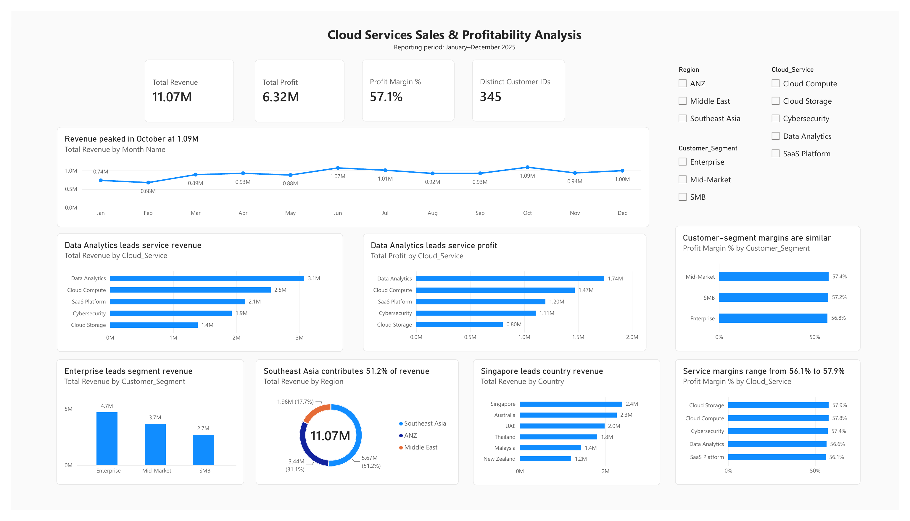

# Cloud Services Sales & Profitability Analysis

**Independent portfolio project | Reporting period: 1 January–31 December 2025**



**Read the full case study:** [Cloud Services Sales & Profitability Analysis (PDF)](reports/Cloud_Services_Sales_Profitability_Case_Study.pdf)  
**Open the dashboard export:** [Power BI dashboard (PDF)](Cloud_Services_Sales_Profitability_Dashboard_2025.pdf)

## Project scope

This independent portfolio project uses a simulated cloud-services sales dataset prepared for practice. It demonstrates data cleaning, SQL analysis, Power BI dashboard development, and business insight generation. The findings illustrate the analytical approach and do not represent the performance of an actual company.

## Business questions

- What are the recorded revenue, profit, and aggregate profit margin?
- Which cloud services and customer-segment labels contribute the most revenue and profit?
- How do recorded results differ by region and country?
- How does revenue change month by month?
- Which service–segment combinations merit further margin investigation?

## Tools

- **Python / pandas:** Data preparation, validation, summary analysis, and a monthly revenue chart
- **PostgreSQL / SQL:** KPI calculations and grouped sales/profitability analysis
- **Power BI:** KPI cards, revenue/profit charts, margin comparisons, and interactive slicers

## Key performance indicators

| Metric | Validated result | Definition |
|---|---:|---|
| Total revenue | 11,072,461.41 | Sum of `Revenue` |
| Total profit | 6,318,912.07 | Sum of `Revenue - Cost` |
| Aggregate profit margin | 57.07% | Total profit divided by total revenue |
| Distinct Customer IDs | 345 | Count of distinct ID values; not a verified unique-customer count |

Amounts are reported in dataset units. The data file does not specify a currency.

## Data preparation

- Raw file: 1,512 rows and 8 columns, covering January–December 2025.
- Removed 12 exact duplicate rows.
- Excluded 17 rows with missing `Revenue` or `Cost` after deduplication.
- Prepared analysis table: 1,483 rows and 11 columns, including `Profit`, `Profit_margin`, and `Month`.
- Standardized selected category labels, parsed dates, calculated profit and margin, and added a numeric month field.

One cleaned row is treated as one recorded transaction for row-level analysis. The business meaning of each row has not been independently verified.

## Key findings

1. **Data Analytics leads service revenue and profit.** It recorded 3.08M revenue and 1.74M profit, with a 56.62% aggregate margin.
2. **Enterprise is the largest segment label by revenue and profit.** It recorded approximately 4.70M revenue and 2.67M profit. This describes rows labelled Enterprise, not necessarily a stable customer cohort.
3. **Southeast Asia represents approximately 51.2% of recorded revenue** (5.67M). Regional results remain provisional until country–region mapping issues are reviewed.
4. **Singapore ranks first in recorded country revenue** at approximately 2.39M, followed by Australia at approximately 2.26M.
5. **Monthly revenue peaked in October** at 1,091,352.13 and was lowest in February at 676,718.64. One year of data does not establish recurring seasonality or explain the cause of these changes.
6. **Service margins range from 56.09% to 57.87%.** SaaS Platform is at the lower end and Cloud Storage at the higher end. The lowest service–segment margin is Enterprise × SaaS Platform (55.10%); the highest is Mid-Market × Cloud Storage (58.59%). These are priorities for investigation, not proof of their causes.

## Dashboard features

- Revenue, profit, aggregate margin, and distinct Customer ID KPI cards
- Monthly revenue trend with markers and a zero baseline
- Revenue and profit by cloud service
- Revenue by segment, region, and country
- Margin comparisons by cloud service and customer-segment label
- Slicers for `Region`, `Cloud_Service`, and `Customer_Segment`

`Cloud_Services_Sales_Profitability_Dashboard_2025.pdf` is a static export of the Power BI report. It is not the interactive `.pbix` file.

## Limitations and data-quality notes

- **Customer ID consistency:** 315 of 345 IDs appear across multiple countries, 300 across multiple segment labels, and 287 across multiple regions. `Customer_ID` does not function as a stable unique-customer identifier in this dataset. Do not infer customer retention, churn, lifetime value, or customer concentration from this ID field.
- **Country–region mapping:** Nine rows have country–region assignments inconsistent with the simple mapping used for QA. Regional metrics are shown as recorded and should be reviewed before operational use.
- **Time coverage:** The data covers one calendar year, so the monthly profile is descriptive and does not prove seasonality or causality.
- **Business drivers:** The file does not include granular discount, pricing rationale, unit-cost, sales pipeline, or campaign-attribution fields. Recommendations should be tested against a baseline; no realized business impact is claimed.
- **Currency:** No currency is specified in the source data, so no currency symbol is assumed.

## Repository contents

- `data/cloud_saas_sales_raw.csv` — simulated raw practice dataset
- `data/cloud_saas_sales_clean.csv` — prepared 1,483-row analysis dataset generated by the Python script
- `python/cloud_saas_analysis.py` — data preparation and Python analysis
- `sql/00_create_table.sql` — PostgreSQL table schema for loading the prepared CSV
- `sql/cloud_saas_analysis.sql` — PostgreSQL queries for overall KPIs, service/segment/region/country summaries, monthly change, and service–segment margins
- `reports/Cloud_Services_Sales_Profitability_Case_Study.pdf` — full portfolio case study
- `reports/dashboard_preview.png` — dashboard image preview
- `reports/monthly_revenue_trend_python.png` — chart generated by the Python script
- `Cloud_Services_Sales_Profitability_Dashboard_2025.pdf` — static Power BI dashboard export

## Reproduce the analysis

### Python analysis

1. Use Python 3.10 or newer.
2. Install dependencies from the repository root:

   ```bash
   pip install -r requirements.txt
   ```

3. Run the analysis from the repository root:

   ```bash
   python python/cloud_saas_analysis.py
   ```

4. The script regenerates `data/cloud_saas_sales_clean.csv` and `reports/monthly_revenue_trend_python.png`.

### PostgreSQL analysis

1. Run `sql/00_create_table.sql` in your PostgreSQL client to create `public.cloud_saas_sales_clean` if it does not already exist.
2. Import `data/cloud_saas_sales_clean.csv` into that table using your client’s CSV import feature, with the header row enabled and columns mapped by name. Alternatively, from the repository root in `psql`, use:

   ```sql
   \copy public.cloud_saas_sales_clean FROM 'data/cloud_saas_sales_clean.csv' WITH (FORMAT csv, HEADER true);
   ```

3. Ensure the table is empty before importing, or truncate the existing table before re-importing to avoid duplicate rows.
4. Run the queries in `sql/cloud_saas_analysis.sql`.

## Contact

For portfolio enquiries, use the GitHub profile: [JessJiDataAnalyst](https://github.com/JessJiDataAnalyst). Additional public contact details can be added after they are confirmed.

## Interpretation note

The analysis is descriptive. Results identify patterns worth investigating; they do not establish why those patterns occurred or prove that a recommendation will improve business performance.
